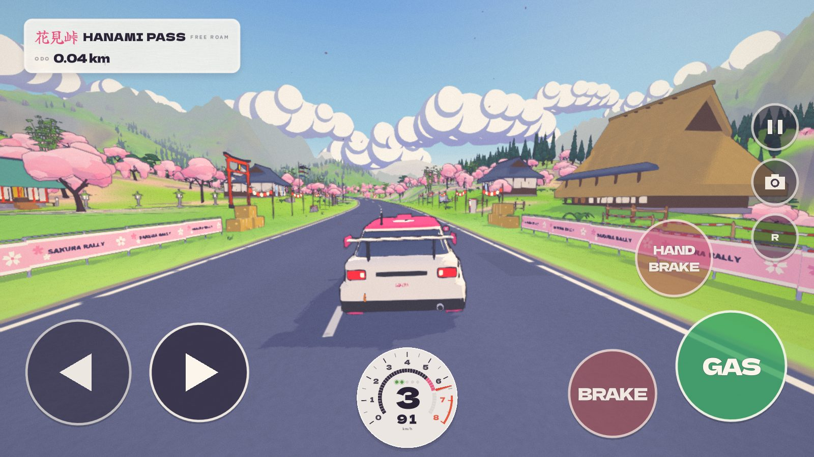

# Game-development-3rd-party-

Ready-to-publish Android builds of **third-party MIT-licensed games**, picked from the
[awesome-opus-5.5-games](https://github.com/Rishidev-20thcenturey/awesome-opus-5.5-games) catalogue.

## ⬇️ Download

**[Download Turbo Kart Rally — APK v1.0.0](https://github.com/Rishidev-20thcenturey/Game-development-3rd-party-/raw/main/downloads/TurboKartRally-v1.0.0.apk)** (0.6 MB, Android 7.0+)

SHA-256: `6e2efad7782888e3458f4d959cb021d4f544af05dbafed0a93518a0c2d521d73`

On your phone, open the downloaded file and allow **Install unknown apps** when Android asks.

## Games

| Game | Download | Source | License |
| --- | --- | --- | --- |
| 🏁 **[Turbo Kart Rally](games/turbo-kart-rally/)**: arcade 3D kart racer, 8 racers, 8 items, AI rivals, touch controls, fully offline | [**APK v1.0.0** (0.6 MB)](https://github.com/Rishidev-20thcenturey/Game-development-3rd-party-/raw/main/downloads/TurboKartRally-v1.0.0.apk) | [bridge-mind/turbo-kart-rally](https://github.com/bridge-mind/turbo-kart-rally) | MIT |
| 🌸 **[Sakura Rally](games/sakura-rally/)**: cel-shaded Godot 4.7 rally through spring and autumn Japan, with a campaign, time trial, free roam, two cars, replays and touch controls | [**APK v1.0.0** (release)](https://github.com/Rishidev-20thcenturey/Game-development-3rd-party-/releases/download/sakura-rally-v1.0.0/SakuraRally-v1.0.0.apk) | [SummerEngine/sakura-rally](https://github.com/SummerEngine/sakura-rally) | MIT (fonts OFL; music: see notes) |

<p align="center">
  
  
</p>

[`docs/game-selection.md`](docs/game-selection.md) explains how Turbo Kart Rally was chosen from 4,128 catalogue entries: 900 license checks, 130 MIT candidates, then a ranking for APK fit.

## Repository layout

```
downloads/            built APKs (+ .sha256) for the small web-based games
games/<game>/         game sources or mobile layer, Android wrapper, build script, license + notices
.github/workflows/    CI builds for the engine games (Godot → APK → GitHub Release)
tools/android/        SDK-free Android toolchain (fetch-toolchain.sh, zipalign.py)
docs/                 selection notes
```

## Build an APK

```bash
./games/turbo-kart-rally/build-apk.sh        # web game → APK, runs anywhere
```

Sakura Rally is built by GitHub Actions ([workflow](.github/workflows/sakura-rally-android.yml)). Push a change under `games/sakura-rally/`, or run the workflow by hand, and the new APK is published to the release.

You need only `bash`, `curl` and `python3`. The script downloads a pinned toolchain into `.cache/` the first time it runs.
