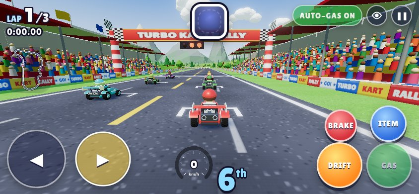

# Game-development-3rd-party-

Ready-to-publish Android builds of **third-party MIT-licensed games**, picked from the
[awesome-opus-5.5-games](https://github.com/Rishidev-20thcenturey/awesome-opus-5.5-games) catalogue.

## Games

| Game | Download | Source | License |
| --- | --- | --- | --- |
| 🏁 **[Turbo Kart Rally](games/turbo-kart-rally/)**: arcade 3D kart racer, 8 racers, 8 items, AI rivals, touch controls, fully offline | [**APK v1.0.0** (0.6 MB)](downloads/TurboKartRally-v1.0.0.apk) | [bridge-mind/turbo-kart-rally](https://github.com/bridge-mind/turbo-kart-rally) | MIT |

<p align="center"></p>

[`docs/game-selection.md`](docs/game-selection.md) explains how this game was chosen from 4,128 catalogue entries: 900 license checks, 130 MIT candidates, then a ranking for APK fit.

## Repository layout

```
downloads/            built APKs (+ .sha256)
games/<game>/         web build, Android wrapper, build script, license + notices
tools/android/        SDK-free Android toolchain (fetch-toolchain.sh, zipalign.py)
docs/                 selection notes
```

## Build an APK

```bash
./games/turbo-kart-rally/build-apk.sh
```

You need only `bash`, `curl` and `python3`. The script downloads a pinned toolchain into `.cache/` the first time it runs.
