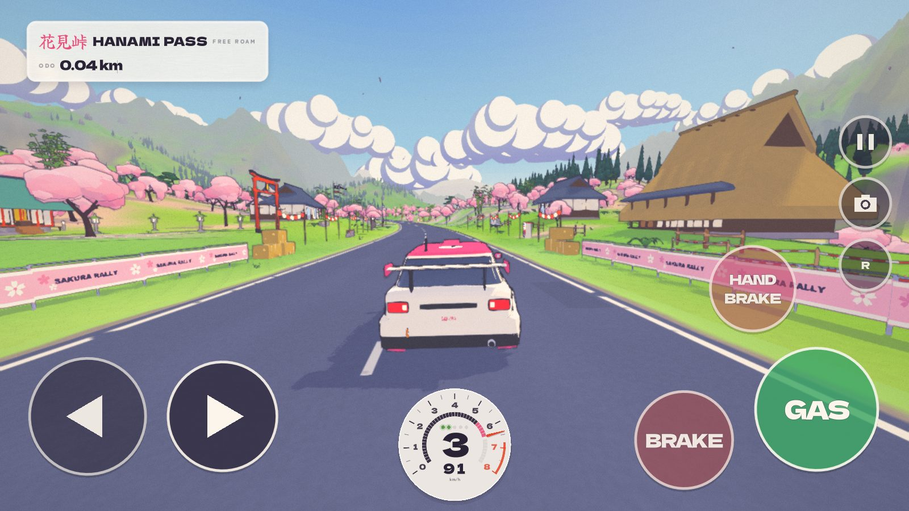
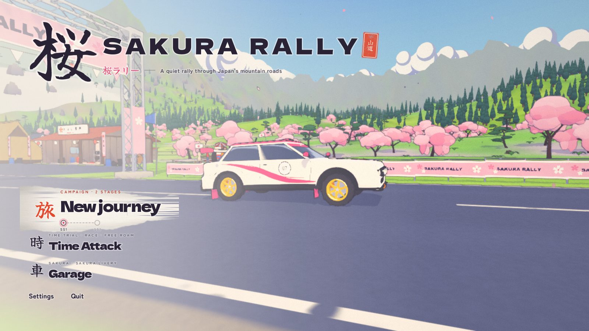

# Sakura Rally: Android build

A cel-shaded rally game through Japanese mountains in spring and autumn, made in **Godot 4.7**.
This folder repackages it as an **Android APK with touch controls**.
Upstream: [SummerEngine/sakura-rally](https://github.com/SummerEngine/sakura-rally), MIT © 2026 Summer Engine.

<p align="center">
  
  
</p>
<p align="center"><sub>These frames are rendered by CI on every build: the Mobile renderer at a 20:9 phone aspect ratio, with the touch controls driving.</sub></p>

## ⬇️ Download

**[SakuraRally-v1.0.0.apk](https://github.com/Rishidev-20thcenturey/Game-development-3rd-party-/releases/download/sakura-rally-v1.0.0/SakuraRally-v1.0.0.apk)** is on the [Sakura Rally release page](https://github.com/Rishidev-20thcenturey/Game-development-3rd-party-/releases/tag/sakura-rally-v1.0.0).
GitHub Actions builds it from source on every change; the build details are in [`docs/ci/build-info.txt`](docs/ci/build-info.txt).

| | |
| --- | --- |
| Package | `com.rishidev.sakurarally` |
| Android | 7.0+ (arm64-v8a). Needs a Vulkan GPU for the Mobile renderer and falls back to OpenGL ES 3 otherwise |
| Permissions | `VIBRATE` only (no internet) |
| Engine | Godot 4.7.2-stable, Mobile renderer |

To install, open the APK on your phone and allow **Install unknown apps**. This is a full 3D game, so a mid-range or better phone is recommended.

## What's in the game (all of it is in the APK)

- **Campaign**: SS1 Hanami Pass (spring) → a 2 km open liaison road → SS2 Momiji Valley (autumn), one continuous world, classified against six rivals.
- **Time Trial**, with splits, medals and saved records; **Free Roam** with every barrier open; **Race** against AI.
- Two cars with different drivetrains, five liveries, a garage, replays, four cameras, custom rally physics, and city-pop music.

## Touch controls

| Control | Action |
| --- | --- |
| **◀ ▶** (left thumb) | Steer. Slide between the arrows without lifting your thumb |
| **GAS** (big, right thumb) | Throttle. Hold it on the grid for launch control |
| **BRAKE** | Brake, or reverse when stopped |
| **HAND BRAKE** | Handbrake turns and hairpins |
| **▲ ▼** | Manual gear shifts (shown only when Settings → Transmission is Manual) |
| ❚❚ / 📷 / **R** (right edge) | Pause / change camera / reset the car onto the road |
| Android **Back** | Pause while driving, go back in menus, resume from pause, quit from the title screen |

Menus work by tapping. Bluetooth or USB gamepads work too. The controls appear only while you're driving, and the speedometer moves to the bottom centre so your thumbs don't cover it.
On first launch the game uses the **Low** quality preset and fullscreen. You can change both in Settings.

## Performance on low-end phones

Runs smoothly on a Snapdragon 8 Gen 1 tablet. The plan for mid-range and budget phones (same look, smoother frame rate) is in [`docs/PERFORMANCE.md`](docs/PERFORMANCE.md).

## How it's built

The upstream game is **not copied into this repo**. CI downloads the pinned upstream commit and adds this folder on top:

```
games/sakura-rally/
├── build.env              upstream repo + commit, Godot version, app version/package
├── prepare.py             copies mobile/ into the project and adds the Android settings
│                          (as `.mobile` overrides, so desktop is unchanged)
├── mobile/
│   ├── mobile.gd          autoload: phone defaults, Back button, HUD layout, background pause
│   ├── touch_controls.gd  multi-touch overlay that drives the game's InputMap actions
│   └── ci/mobile_check.gd automated test: drives the real game with touch events
├── android/
│   ├── export_presets.cfg Godot Android export preset
│   └── icons/             launcher icons (cropped from upstream cover art)
├── LICENSE                upstream MIT license
└── THIRD_PARTY_NOTICES.md
```

[`.github/workflows/sakura-rally-android.yml`](../../.github/workflows/sakura-rally-android.yml) runs these steps:
1. Install Godot 4.7.2 and the Android export templates, plus JDK 17 and the Android SDK from the runner.
2. Fetch upstream at the pinned commit and run `prepare.py`.
3. Import the project, failing on any script error.
4. Run `mobile_check.gd`, which drives the touch controls, the Back button and backgrounding.
5. Run upstream's own `flows.gd` regression suite with the touch layer active.
6. Render preview screenshots with the **Mobile renderer** on software Vulkan.
7. Export, sign and verify the APK (apksigner, zipalign, aapt2), then publish it to the GitHub Release.

To build locally with Godot 4.7.2 and the Android templates installed:

```bash
curl -L https://codeload.github.com/SummerEngine/sakura-rally/tar.gz/4c2da60c79922a2028752221225577f504aeca46 | tar xz
python3 games/sakura-rally/prepare.py sakura-rally-4c2da60c79922a2028752221225577f504aeca46
godot --headless --path sakura-rally-4c2da60c79922a2028752221225577f504aeca46 --export-release Android SakuraRally.apk
```

## Signing

If the repository secrets `SAKURA_KEYSTORE_BASE64`, `SAKURA_KEYSTORE_PASSWORD` and `SAKURA_KEY_ALIAS` are set, CI signs with that key, which is what you want for the Play Store.
Without them, CI makes a **preview key** and keeps it in the Actions cache, so newer builds install over older ones. The cache is dropped if no build runs for 7 days.

## Before publishing on Google Play

1. **Music rights.** The four music tracks and the ambience beds were made with ElevenLabs models through fal.ai. Upstream says commercial use needs output from a plan with commercial rights. Confirm this with Summer Engine, or swap those audio files, before a paid or ad-supported release. See [`THIRD_PARTY_NOTICES.md`](THIRD_PARTY_NOTICES.md).
2. **Signing key.** Add your own upload key as the secrets above.
3. **App Bundle.** Play needs an `.aab` for new apps. Set `gradle_build/use_gradle_build=true` and `gradle_build/export_format=1` in the preset.
4. **Keep the notices.** The MIT and OFL license texts already ship inside the APK.
