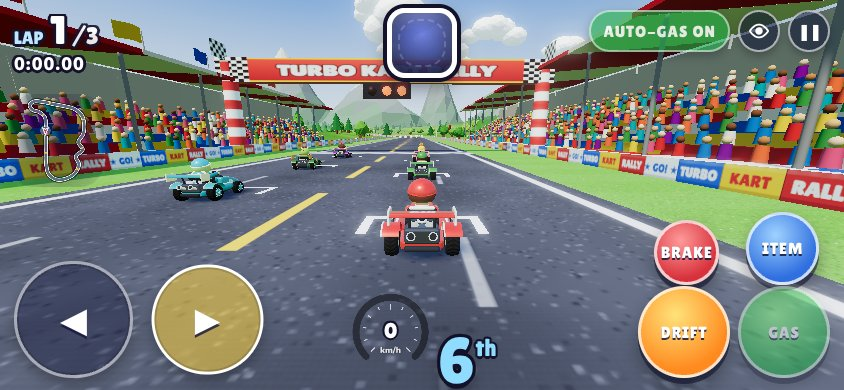
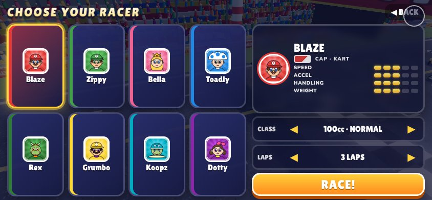

# Turbo Kart Rally — Android build

An arcade 3D kart racer (Three.js), repackaged as an **offline Android app** with touch controls.
Upstream game: [bridge-mind/turbo-kart-rally](https://github.com/bridge-mind/turbo-kart-rally), MIT © 2026 BridgeMind.

<p align="center">
  
  
</p>

## ⬇️ Download

**[`downloads/TurboKartRally-v1.0.0.apk`](../../downloads/TurboKartRally-v1.0.0.apk)** (about 0.6 MB). The SHA-256 is in the `.sha256` file next to it.

| | |
| --- | --- |
| Package | `com.rishidev.turbokartrally` |
| Version | 1.0.0 (code 1) |
| Android | 7.0+ (minSdk 24), targetSdk 35 |
| Needs | OpenGL ES 3.0 (WebGL 2) and an up-to-date Android System WebView |
| Permissions | `VIBRATE` only. No internet; the game runs fully offline |
| Signing | APK Signature Scheme v1 + v2 + v3, with a **preview** key |

To install, copy the APK to the phone, open it, and allow "Install unknown apps" for your file manager or browser.

## Touch controls

| Control | What it does |
| --- | --- |
| **◀ ▶ pad** (left thumb) | Steer. Slide your thumb between the arrows without lifting it |
| **DRIFT** (hold) | Hop and drift. Hold through a corner and release for a mini-turbo (sparks go blue, then orange, then purple) |
| **ITEM** | Use the item you're holding |
| **BRAKE** | Brake or reverse |
| **GAS** | Accelerate. Hold it as the countdown hits GO for a rocket start |
| **AUTO-GAS** | On by default: the kart accelerates by itself once the race starts. Tap to turn it off |
| 👁 / ❚❚ | Look behind / pause |
| Back button | Pauses during a race, goes back in menus, quits from the title screen |

Gamepads (Bluetooth or USB) work too.

## What changed from upstream

- Three.js r170 and the fonts are bundled locally instead of loaded from a CDN or Google Fonts.
- `web/src/touch.js` adds the touch controls. They send the same key events the game already reads, so the driving code is untouched.
- `web/src/mobile.css` gives phones a landscape layout for the HUD, character select, pause and results screens.
- `web/src/platform.js` detects touch devices and the Android app.
- On touch devices the pixel ratio is capped at 1.5× and the shadow map is 1024 instead of 2048, to keep the frame rate up.
- `android/` holds the native wrapper: one Java Activity with a fullscreen immersive WebView. It serves the game from bundled assets at `https://appassets.androidplatform.net/`, handles Back, pauses audio in the background, and recovers if the renderer crashes.

Desktop behaviour is unchanged. Add `?touch=1` to the URL to try the touch UI in a desktop browser.

## Build it yourself

```bash
./games/turbo-kart-rally/build-apk.sh
# → downloads/TurboKartRally-v1.0.0.apk
```

You don't need Android Studio, the Android SDK or Gradle. On first run, `tools/android/fetch-toolchain.sh` downloads a small toolchain (about 60 MB, checksum-pinned) from PyPI, npm and GitHub:
a JRE, aapt2, android.jar (API 35), ecj, apksigner, and **dx built from AOSP source**.

To use your own release key and version:

```bash
VERSION_NAME=1.0.1 VERSION_CODE=2 \
KEYSTORE=/path/to/release.jks KEYSTORE_PASS=... KEY_ALIAS=... \
./games/turbo-kart-rally/build-apk.sh
```

To preview the web version locally: `python3 -m http.server 8080 --directory games/turbo-kart-rally/web`, then open `http://localhost:8080/?touch=1`.

## Before publishing on Google Play

1. **Make your own upload key** and keep it private. The checked-in APK is signed with a throwaway preview key that isn't in the repo, so the next build can't update an install of this one.
2. **Upload an App Bundle (.aab).** Play needs one for new apps; this build makes an APK for sideloading and testing.
3. **Rename the Nintendo-like names**: *Toadly*, *Koopz*, and the mushroom/shell/star items. Keep "Mario Kart" out of the listing. See [`docs/game-selection.md`](../../docs/game-selection.md).
4. Keep the MIT notice: `LICENSE` and [`THIRD_PARTY_NOTICES.md`](THIRD_PARTY_NOTICES.md) already ship inside the APK under `assets/www/`.
5. Store assets: `android/play-store-icon-512.png` is the 512×512 icon. The screenshots in `docs/` work as a starting point.

## Layout

```
games/turbo-kart-rally/
├── web/                 the game (upstream + mobile layer), served as-is
├── android/             manifest, resources and icons, MainActivity.java
├── build-apk.sh         one-command APK build
├── LICENSE              upstream MIT license (BridgeMind)
├── THIRD_PARTY_NOTICES.md
├── UPSTREAM_README.md   original README, including the prompt that built the game
└── docs/                screenshots + upstream ARCHITECTURE.md
```
